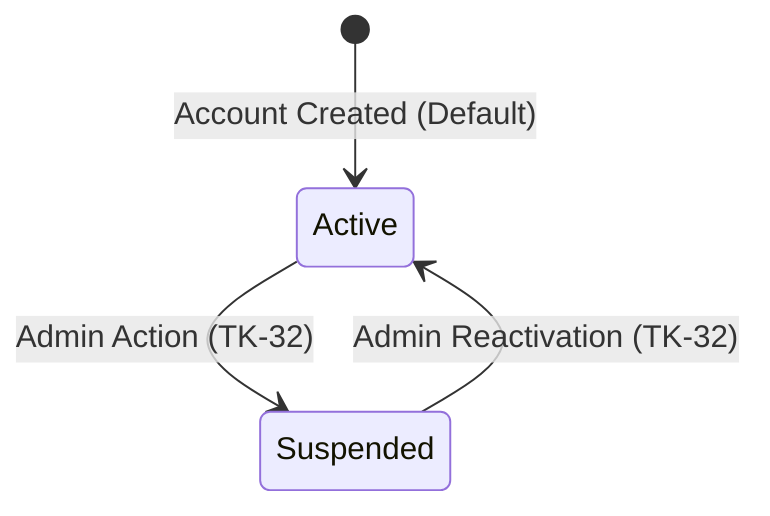

# Data Model: Custom User Model and Email Authentication (TK-03)

## Entities

### `accounts.User` (Table: `accounts_user`)
The foundational identity model representing all platform actors (Customers, Sellers, Administrators).

#### Fields & Attributes

| Field Name | Type | Nullable | Default | Description & Constraints |
|---|---|---|---|---|
| `id` | `BigAutoField` | No | Auto | Primary Key (64-bit integer) |
| `password` | `CharField(128)` | No | — | PBKDF2 hashed password string (`AbstractUser`) |
| `last_login` | `DateTimeField` | Yes | `None` | Timestamp of most recent authentication |
| `is_superuser` | `BooleanField` | No | `False` | Administrative superuser flag (`AbstractUser`) |
| `is_staff` | `BooleanField` | No | `False` | Administrative dashboard access flag (`AbstractUser`) |
| `is_active` | `BooleanField` | No | `True` | Standard Django active status flag |
| `date_joined` | `DateTimeField` | No | `timezone.now` | Account creation timestamp |
| `email` | `EmailField(254)` | No | — | Unique login identifier (`USERNAME_FIELD`). Exact unique index + case-folded index (DR-01) |
| `name` | `CharField(120)` | No | — | Full display name of the user (`REQUIRED_FIELDS`) |
| `role` | `CharField(16)` | No | `'customer'` | Actor classification enum: `customer`, `seller`, `admin` |
| `status` | `CharField(16)` | No | `'active'` | Account lifecycle enum: `active`, `suspended` |
| `groups` | `ManyToManyField(Group)` | No | `[]` | Permission groups association (`auth.group`) |
| `user_permissions`| `ManyToManyField(Permission)` | No | `[]` | Explicit user permissions (`auth.permission`) |

*Omitted Fields*: `username`, `first_name`, `last_name` are removed (`None`).

#### Enumerations

##### `User.Role` (`models.TextChoices`)
- `CUSTOMER = 'customer'` (Standard buyer role)
- `SELLER = 'seller'` (Merchant role with seller profile)
- `ADMIN = 'admin'` (Platform administrator role)

##### `User.Status` (`models.TextChoices`)
- `ACTIVE = 'active'` (Account is in good standing)
- `SUSPENDED = 'suspended'` (Account is disabled from active operations)

#### Database Constraints

1. **Exact Uniqueness**: `email` field-level `unique=True` (B-tree unique index).
2. **Case-Insensitive Uniqueness (DR-01)**:
   ```python
   models.UniqueConstraint(Lower('email'), name='uniq_email_ci')
   ```
   Ensures that entries such as `john@example.com` and `John@Example.com` collide at the PostgreSQL storage engine level.

#### State Transitions



- **Default State**: Initial user status is always `active`.
- **Suspension**: When status is `suspended`, the user is denied authenticated API requests (enforced downstream in TK-06).
